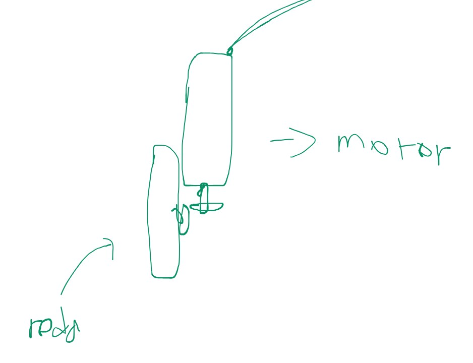
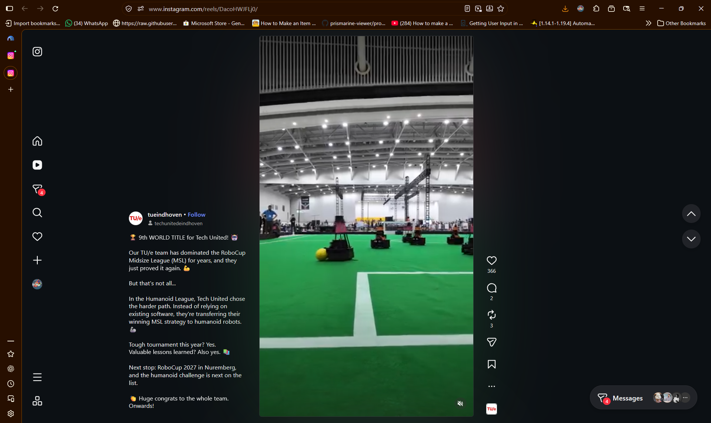
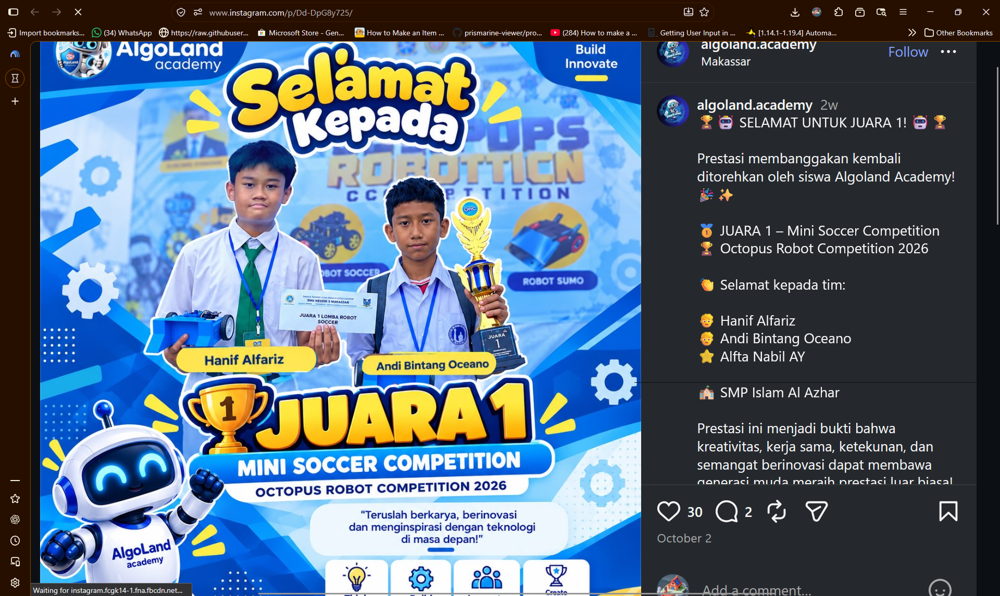

closing eric unj 2026 - https://www.youtube.com/live/OFYB2cfvnSU?si=QakR6SRcZZy-f0Yx&t=8369

## trade-off analysis

### wheel

| Design Option         | Pros                                                      | Cons                                                                                                             | Decision       |
| --------------------- | --------------------------------------------------------- | ---------------------------------------------------------------------------------------------------------------- | -------------- |
| 4WD Silicone          | - Great grip traction (..until dirt)                   | - Silicone sticks dirt easily, slipping afterwards - Uses more power to move                                  | Good           |
| 4WD Mecanum           | - Able to move more freely sideways                       | - Low traction                                                                                                   | No             |
| 2WD Silicone + Caster | - Space efficient - Rotates easily during turns        | - Silicone sticks dirt easily, slipping afterwards                                                               | Preferably not |
| 6WD Silicone          | - Best traction (referenced from Malaysia's winning team) | - Needs high power to move.. or belt drive (and insanely expensive) - No space for solenoid.. unless h-bridge | Better         |

| Material Option | Pros        | Cons                                                    | Decision  |
| --------------- | ----------- | ------------------------------------------------------- | --------- |
| Rubber          | -           | - Requires molding (high temperature) for custom sizing | Maybe not |
| Silicone        | - Best grip | - Easily tear & pick up dirt                            | Better    |
| TPU             | -           | -                                                       | Better    |

### kicker

| Design Option        | Pros                                                        | Cons                                                                                                                                               | Decision   |
| -------------------- | ----------------------------------------------------------- | -------------------------------------------------------------------------------------------------------------------------------------------------- | ---------- |
| No kicker            | - More space designated for wheel optimization              | - Can't shoot ball without moving - Can't **participate** in penalty kick                                                                       | Maybe      |
| Solenoid kicker      | - Able to launch ball without moving bot                    | - Uses huge space                                                                                                                                  | Preferably |
| Retractable flywheel | - Can shoot balls faster - Easily control shooting speed | - Lowers the possibility of collision dampening (as it's in front, unlike solenoid) - Needs a retractable system (might be teeny weeny complex) | Maybe not  |

## drivetrain

| Design Option                                                                | Pros                                          | Cons                                                                        | Decision  |
| ---------------------------------------------------------------------------- | --------------------------------------------- | --------------------------------------------------------------------------- | --------- |
| Direct drive                                                                 | - Less friction - Better center of gravity | - Eats up space                                                             | Maybe     |
| H-bridge (gears, motor from above)   | - Space can be allocated to others            | - Prone to damage, especially during collision - Worse center of gravity | Maybe not |

## reference

### RoboCup 2026 - 9th World

<video controls>
	<source src="assets/AQPcAXztxxP3Fwl1QkZdztBPVCHZmimtdu1Oc8Nmsn3FY94ErY93WBl2LKsOF7L-Dlvjr8-rmm2Fti0wIzDBq4l3aPunS91twu9TxME.mp4">
</video>

https://www.instagram.com/reels/DacoHWJFLj0/

### SINOX-01 UNAIR x ITS - November 2024 - 3rd Place

<video controls>
	<source src="assets/AQNKG3elItdhhHkz3jDOoknWLljec4DLdTw-Jvju-MskvhcBBKZaodgBE_KEYs8__U1QHlKvdqyRS_SSQGFXAQeTDrgJWLCljqUgNMU.mp4">
</video>

https://www.instagram.com/reels/DDOH0yyzbtL/

### Octopus Robot Competition 2026 - 1st Place

https://www.instagram.com/p/Dd-DpG8y725/

